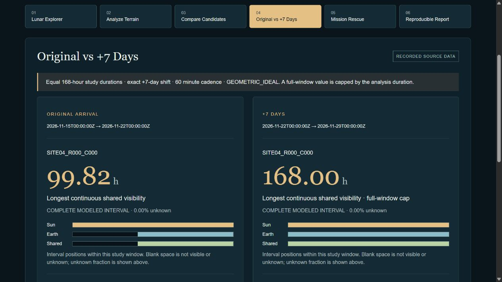

# WISPR — Lunar Mission Intelligence

**Explore lunar terrain. Compare mission timing. Keep every result traceable.**

🌕 **[Open the WISPR website](https://nasa-lunar-x2her4ehyq-el.a.run.app/)** · [Judge demonstration](docs/JUDGE_DEMO.md) · [Audit and verification](docs/JUDGE_AUDIT.md) · [API contracts](docs/contracts/API_V1.md)

WISPR is a NASA Space Apps 2026 lunar mission-planning **research prototype**. It combines NASA-derived terrain measurements with JPL Horizons Sun/Earth observations to show how a change in arrival time affects modeled visibility. It does not certify landing safety, electrical power or radio communications.

> **Release status:** The website runs a separate, previously deployed WISPR release. The six-stage Judge Mode in this branch is a reviewed-change candidate, not a claim that the website has already been updated. See the [deployment comparison](docs/JUDGE_AUDIT.md#repository-and-deployment).



## What you can do

| Capability | What it actually provides |
|---|---|
| Lunar explorer | Original Site04 geographic identities and projected footprints; the technical interface also exposes the configured global atlas. |
| Terrain analysis | Source-backed mean elevation, slope and plane-fit roughness, with resolution and missing uncertainty stated. |
| Candidate comparison | Select real cells; preserve dataset identity, coordinates and settings in browser storage. |
| Original vs +7 days | Equal-duration comparisons of Sun, Earth and shared visibility using the existing deterministic science engine. |
| Mission rescue | Evaluate explicitly selected candidates against supplied constraints. Missing evidence is excluded from ranking. |
| Research report | ZIP containing readable Markdown, a summary SVG and exact analyzed JSON evidence with source hashes. |
| Optional AI | Existing server-side Groq/NVIDIA mission-input extraction, validated against backend schemas. Manual operation needs no API key. |

There is **no embedding-based retrieval claim**: the global document retrieval implementation uses keyword overlap. Physical terrain similarity uses separately normalized physical measurements. Gemini support in the separately deployed application is not present in this repository baseline.

## A reproducible scientific example

The bundled example uses authentic recorded NASA responses, checked against exact query parameters, raw SHA-256 hashes and source headers before recomputation.

| Original cell | November 15–22, 2026 UTC | November 22–29, 2026 UTC |
|---|---:|---:|
| `SITE04_R000_C000` | 99.82 h | 168.00 h |
| `SITE04_R000_C001` | 99.81 h | 168.00 h |

These are **longest modeled continuous shared Sun/Earth visibility windows**. Each study lasts 168 hours, with 60-minute sampling and an ideal local horizon. The delayed result is **capped by that study window**. The approximately 21-second difference between the original cells is below the cadence and does not demonstrate meaningful superiority. Terrain obstruction is not included in these values.

Sources: [NASA LOLA Site04](https://pgda.gsfc.nasa.gov/products/78), [JPL Horizons API documentation](https://ssd-api.jpl.nasa.gov/doc/horizons.html), [original scientific verification](docs/SCIENTIFIC_BACKEND_VERIFICATION.md), [new regression tests](backend/tests/test_judge.py).

## Run Judge Mode locally

Requirements: Python 3.12 or 3.13, Node.js 22+, and [uv](https://docs.astral.sh/uv/). From the repository root, in PowerShell:

```powershell
uv sync --project backend --locked --extra test --extra terrain --extra lint
npm --prefix frontend ci
$env:VITE_API_BASE_URL='/'
npm --prefix frontend run build
cd backend
uv run --no-sync python -m scripts.judge_preview
```

Open **http://127.0.0.1:8027/**. API documentation is at **http://127.0.0.1:8027/docs**. The technical interface remains available at **http://127.0.0.1:8027/#technical**.

The recorded two-cell demonstration works without an API key, external DEM installation or NASA network request. Other dates, more extensive terrain, the global atlas and configured-source evaluation require their actual registered datasets and matching observations. Missing coverage remains unknown.

For frontend development, start the API on port 8000 and run `npm --prefix frontend run dev`; see [the preserved technical setup guide](docs/LEGACY_SETUP.md) and [backend configuration](backend/README.md). Never place API keys in `VITE_*` variables or commit them. Environment examples are not loaded automatically by the backend.

## Judge walkthrough

1. **Lunar Explorer:** inspect the original Site04 cell footprints and expand provenance.
2. **Analyze Terrain:** explain elevation, slope and roughness; save both cells as candidates.
3. **Compare Candidates:** use November 15, 2026 at 00:00 UTC, 168 hours, 60-minute cadence and a 60-minute required shared window. Explicitly accept missing terrain uncertainty for geometry comparison.
4. **Original vs +7 Days:** compare the paired timelines and explain the full-window cap.
5. **Mission Rescue:** review the deterministic decision; adjust a constraint to demonstrate exclusions rather than invented alternatives.
6. **Reproducible Report:** download the Markdown/image/evidence bundle.

[Full speaking script, failure cases and screenshots →](docs/JUDGE_DEMO.md)

## Architecture and repository map

| Path | Responsibility |
|---|---|
| `frontend/src/JudgeMode.tsx` | Curated six-stage presentation; existing technical UI is preserved. |
| `frontend/src/main.tsx`, `GlobalExplorer.tsx` | Technical mission forms, legacy recovery and global atlas. |
| `backend/app/judge.py` | Bounded presentation adapter, recorded-source evaluation and exact-result export. |
| `backend/app/integration/` | Original grid contract, physical vectors, selected-cell analysis and seven-day comparison. |
| `backend/celestial_engine/` | Horizons queries, source validation, cache and aligned Sun/Earth observations. |
| `backend/app/providers/` | Terrain, conditional horizon diagnostics and optional language providers. |
| `backend/lunar_global/` | Global indexing, registered source layers, crosswalks and physical/keyword retrieval. |
| `backend/tests/`, `backend/celestial_engine/tests/`, `backend/lunar_global/tests/` | Regression, contract and opt-in source verification. |
| `docs/evidence/`, `docs/contracts/` | Scientific evidence, generated contracts and audit trail. |

## Verification

```powershell
cd backend
uv run --no-sync python -m pytest -q -rs
uv run --no-sync python -m scripts.export_science_contract --check
cd ..
npm --prefix frontend test
$env:VITE_API_BASE_URL='/'
npm --prefix frontend run build
```

The frontend fixture suite is explicitly synthetic and checks interface behavior; it is not scientific validation. The Judge Mode regressions use authentic recorded NASA data. Live NASA and full external-asset checks are opt-in and report missing dependencies as skips. Current executed results and exact limitations are in [JUDGE_AUDIT.md](docs/JUDGE_AUDIT.md).

## Scientific and operational limits

- Geometric sunlight is not generated electrical power; Earth line of sight is not a radio link budget.
- DEM/Horizons vertical-reference alignment and complete distant terrain visibility remain unresolved. Partial skyline diagnostics cannot certify terrain-clear visibility.
- A 5 m raster spacing does not imply 5 m positional accuracy or independent laser observations in every pixel.
- The curated offline example contains two real cells, not a whole-Moon high-resolution mission solution. Unsupported requests do not get synthetic replacements.
- Reports are retained in a bounded 16-entry in-memory store. Download before restart or eviction; otherwise reevaluate. Candidate/settings persistence is local to the browser and tied to the dataset hash.
- AI cannot supply physical measurements, alter deterministic ranking, or declare a safe landing site. Optional provider access was not configured in the audited local environment.
- This local preview is not a new cloud deployment. Internet-facing access control, persistent multi-instance report storage and release integration require separate operational review.

## Evidence and further reading

- [Judge audit, actual status and test evidence](docs/JUDGE_AUDIT.md)
- [Scientific backend verification](docs/SCIENTIFIC_BACKEND_VERIFICATION.md)
- [Terrain-horizon validation and remaining reference limitations](docs/TERRAIN_HORIZON_VALIDATION.md)
- [Global data provenance](docs/GLOBAL_DATA_PROVENANCE.md)
- [Physical vectors and keyword retrieval](docs/VECTOR_RETRIEVAL_CONTRACT.md)
- [Frontend integration/API handoff](docs/FRONTEND_INTEGRATION_HANDOFF.md)
- [Original technical setup preserved](docs/LEGACY_SETUP.md)

**WISPR is not flight-qualified, NASA-approved, or a landing-safety certification system.**
