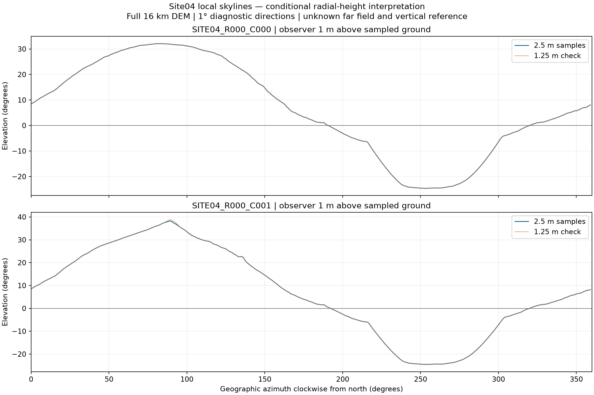

# Site04 terrain-horizon validation — 2026-11-14

The implementation produces local skyline diagnostics for original V3 cells,
with obstruction coordinates, distances and sampled elevations, and preserves
unknown physical visibility. The DEM-to-Horizons vertical reference has **not**
been independently established. The reported angles therefore explicitly assume
radial height above the declared lunar sphere; they are not terrain-certified
Sun/Earth visibility results.

## Source integrity and full raster

The original `Site04_final_adj_5mpp_surf.tif` was read from Narinder's frozen
`WISPR_Site04_Tiling_V3`, without rebuilding or editing it. SHA-256 matched both
the package manifest and baseline metadata:

```text
38ff70dbdf2f066c2cfa94a646c3a59d653ce7f6b4528b15fc1b43ee397ce758
```

The SHA-256 of the package's manifest itself is
`694911f0b0caae7b6071b525d229f3ea7a88592fa38d39c9d8d195701ab36efe`.
This verifies consistency with the supplied frozen package; it is not a digital
signature or a new independent download of the raster.

| Property | Verified value |
|---|---|
| Dimensions | 3200 × 3200 pixels, float32 |
| Pixel spacing | 5 × 5 m |
| Affine (a, b, c, d, e, f) | (5, 0, -9000, 0, -5, 1000) |
| Bounds (left, bottom, right, top) | (-9000, -15000, 7000, 1000) m |
| Projection | Native south polar stereographic, sphere radius 1737400 m |
| Frame declaration | NASA/V3 MOON_ME / DE421 |
| Valid / invalid source pixels | 10,240,000 / 0 |
| NoData declaration | NaN; full mask and nonfinite values checked |
| Minimum / maximum source Z | -2847.877198 / 1805.072632 m |
| Mean source Z | 245.343792 m |

The entire 16 × 16 km raster supports ray calculations. The preserved grid is
only 2 × 2 km and is used for original cell identities and observing positions.
The original V3 reader also checks baseline/tile checksums and consistency.
Full WKT and consumed-file hashes are in
[source_validation.json](evidence/terrain-horizon/source_validation.json).

## Two original cells

Default runs use 1 m radial observer height, 2.5 m ray spacing, bilinear source
sampling, and 360 diagnostic directions at 1° spacing.

| Quantity | SITE04_R000_C000 | SITE04_R000_C001 |
|---|---:|---:|
| Original projected center X, Y (m) | -1450, -6550 | -1350, -6550 |
| Original latitude (degrees) | -89.7787655990766 | -89.779454879477 |
| Longitude east (degrees, wrapped) | 192.48248938495448 | 191.6459742484832 |
| DEM ground sampled at center (m) | 1072.247406 | 1008.335648 |
| Minimum local skyline angle (degrees) | -24.631510 | -24.529222 |
| Maximum local skyline angle (degrees) | 32.106208 | 38.272912 |
| Supported sample radii across directions (m) | 7547.5–11845.0 | 7547.5–11812.5 |
| First skyline calculation (seconds) | 6.47 | 7.21 |
| Cached retrieval (seconds) | 0.014 | 0.015 |

Times are measurements on this development machine, not performance guarantees.
Only these two cells were calculated by the report generator. Tests additionally
exercise the opposite-corner original cell; no all-400 horizon sweep occurred.
All 360 rays for each report cell stopped at the source boundary. Support is a
sample prefix and does not imply continuous or far-field coverage.



The JSON files contain all 360 peaks with original DEM coordinates, geographical
coordinates, sampled source elevation, distance and first unsupported sample:

- [SITE04_R000_C000](evidence/terrain-horizon/SITE04_R000_C000.json)
- [SITE04_R000_C001](evidence/terrain-horizon/SITE04_R000_C001.json)

## Resolution check and uncertainty

The same directions were recomputed at 1.25 m spacing. Maximum observed skyline
increases were **0.056055°** and **0.724629°**, respectively; RMS differences were
0.006912° and 0.084471°. Finer distances can resolve a nearby slope or crest that
the coarser distances miss. These values describe only this comparison and are
not confidence intervals or rigorous error bounds. Neither run guarantees the
continuous maximum or unseen subpixel topography. This is why clearance remains
uncertified and a coarse preview is not used for arbitrary NASA directions.

The source package does not include its per-pixel LOLA counts or uncertainty
rasters. No measurement accuracy is inferred from the 5 m pixel spacing, and no
global bound is inferred from published regional RMS statistics.

## NASA comparison and compatibility evidence

The comparison reuses original recorded Horizons responses for these exact
centers, requested for 2026-11-15 through 2026-11-22 at hourly cadence and 0 km
reference altitude. The first three original UTC records per cell are retained
verbatim. Their actual Sun and Earth azimuths receive new rays; there is no
angular or time interpolation. Original raw-response checksums, headers, request
parameters and angle values are preserved and revalidated with the unchanged
Celestial Engine parser. These are recorded-response tests, not fresh NASA calls.

- [Cell 000 NASA comparison](evidence/terrain-horizon/SITE04_R000_C000_horizons_comparison.json)
- [Cell 001 NASA comparison](evidence/terrain-horizon/SITE04_R000_C001_horizons_comparison.json)

The NASA product page identifies the DEM's lunar frame and projected units.
The Horizons manual defines observer altitude above its reference surface,
east-positive lunar longitude, and lunar mean-Earth frame. Those facts do not
prove the DEM Z-to-radius conversion. The frozen package explicitly says to
verify that conversion before using observer elevation. The linked NASA README
could not be retrieved during this run (web unsupported content type; direct
requests timed out), so no additional datum claim is based on it.

Both cells have `DEM_VERTICAL_REFERENCE_UNVERIFIED` and
`OBSERVER_POSITION_OR_ALTITUDE_MISMATCH`. The latter arises from the altitude:
0 km is not their sampled terrain plus 1 m under the diagnostic radial model.
The observing horizontal coordinates do match. No NASA values or datum labels
were changed to hide either failure. All 12 displayed target comparisons are
`UNKNOWN`. Far-field completeness is false and the hard terrain-error bound is
unresolved. All results are target-center only, with no solar-disk illumination
claim.

Primary references checked on 2026-11-14:

- [NASA PGDA high-resolution LOLA product documentation](https://pgda.gsfc.nasa.gov/products/78)
- [JPL Horizons manual: observer coordinates and lunar frame](https://ssd.jpl.nasa.gov/horizons/manual.html)
- Frozen V3 `README.md`, `baseline/grid_metadata.json`, `SHA256_MANIFEST.json`, and original raster metadata (hashes in source evidence).

## Automated validation

Analytical tests compare the elevation routine to independently constructed
Moon-centered vectors, including nonzero absolute ground elevation, and to exact
flat-sphere and elevated-observer tangent solutions. Raster tests cover a single
ridge, observer-height changes, direction specificity, NoData before an unseen
ridge, source boundaries, interpolation-invalid observers, near-pole rays,
exact-pole rejection, all 360 azimuths, wraparound, wrong IDs/coordinates,
checksum failures, incompatible height references, unknown hard error bounds,
and conservative visibility gates. Cache copy isolation and reference-sensitive
keys are tested. Real tests use the complete Site04 DEM and authentic recorded
NASA responses, including deliberate checksum and angle corruption.

The backend regression run passed **198 tests**, with two live-network tests
explicitly deselected. The upstream Starlette transport deprecation warning does
not affect test outcomes. See [pytest evidence](evidence/terrain-horizon/pytest.txt).
Environment versions and machine timings are recorded in the source evidence.

See [integration handoff](TERRAIN_HORIZON_HANDOFF.md) for the Python interface,
reproduction commands, exact geometry, and the remaining certification gates.
