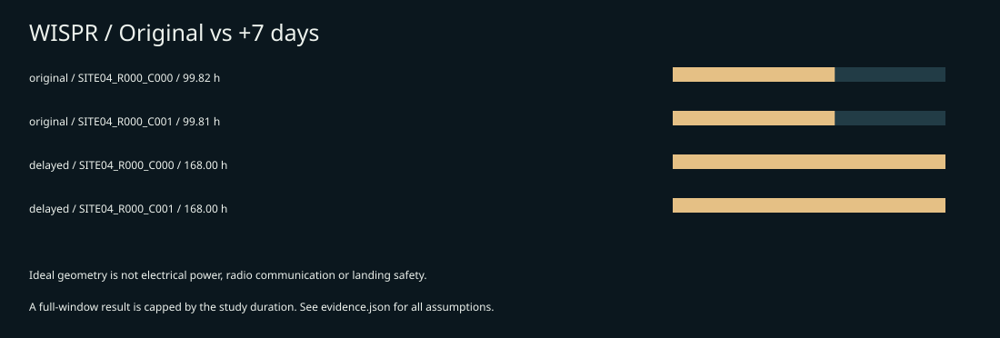

# WISPR — reproducible mission comparison



Source mode: **recorded**. Outcome: **KEEP**.

Original location still meets supplied constraints

| Scenario | Cell | Longest shared / h | Unknown fraction |
|---|---|---:|---:|
| original | SITE04_R000_C000 | 99.82 | 0.0 |
| original | SITE04_R000_C001 | 99.81 | 0.0 |
| delayed | SITE04_R000_C000 | 168.00 | 0.0 |
| delayed | SITE04_R000_C001 | 168.00 | 0.0 |

## Selected terrain measurements

| Cell | Latitude / deg | Longitude east / deg | Elevation / m | Slope / deg | Roughness / m |
|---|---:|---:|---:|---:|---:|
| SITE04_R000_C000 | -89.7787655990766 | -167.51751061504552 | 1072.0976434326171 | 32.13135594956228 | 0.9163221785602584 |
| SITE04_R000_C001 | -89.779454879477 | -168.3540257515168 | 1008.3839926147461 | 33.10994714843948 | 0.908064780045918 |

Elevation is cell-mean source height, slope is mean native-pixel gradient angle, and roughness is the RMS residual from a fitted plane. The preserved dataset metadata defines the exact methods and sampling scale.


## Inputs and methodology

```json
{
  "latitude_deg": 0.0,
  "longitude_east_deg": 0.0,
  "altitude_km": 0.0,
  "altitude_reference": "horizons_lunar_reference",
  "start_utc": "2026-11-15T00:00:00Z",
  "end_utc": "2026-11-22T00:00:00Z",
  "step_minutes": 60,
  "dataset_id": "SITE04_NW_ORIGIN_PRESERVED_2KM_100M__tiles_3.0.0",
  "cell_ids": [
    "SITE04_R000_C000",
    "SITE04_R000_C001"
  ],
  "horizon_model": "GEOMETRIC_IDEAL",
  "terrain_site_id": null,
  "observer_height_m": 1.0,
  "minimum_shared_minutes": 60.0,
  "filters": {
    "region": null,
    "bbox": null,
    "minimum_coverage": 1.0,
    "qualities": [
      "source_lola_count_and_uncertainty_not_supplied"
    ],
    "maximum_slope_deg": null,
    "maximum_roughness_m": null,
    "minimum_elevation_m": null,
    "maximum_elevation_m": null,
    "offset": 0,
    "limit": 100
  },
  "original_cell_id": "SITE04_R000_C000",
  "source_mode": "recorded"
}
```

Exact seven-day shift; equal study durations. Piecewise-linear boundaries between adjacent samples; missing samples remain unknown.
Timing resolution is the stated cadence, not the printed decimal precision. Differences below one cadence do not establish superiority.
GEOMETRIC_IDEAL uses target-center elevation above zero. TERRAIN_PARTIAL cannot certify an unobstructed far-field skyline.
Horizons altitude is relative to its lunar reference; DEM elevation is not substituted. The observer-height setting applies to the terrain engine only.
Full-window visibility is censored at the evaluation endpoints, not a prediction beyond them.

## Reproduce and verify

POST the request in evidence.json to /api/v1/judge/evaluate. Recorded mode requires the matching checked NASA cache; unsupported dates remain unknown.
evidence.json SHA-256: `ce21d76432ce442357c68af1b7d7a3a50a0352f61e018b5f0f6d577bee7436b5`

evidence.json retains raw source hashes, request URLs, observer coordinates, source versions, static values, model settings, intervals, exclusions and limitations.
Terrain is an interpolated LOLA DEM; missing shot counts and elevation uncertainty remain unknown. No landing-safety certification.

## Source records

- original / SITE04_R000_C000 / sun: VERIFIED_CACHE; SHA-256 `a95dce94c5a211392f2e53d8078edbf29555453fb5194bf955a0a6b431478b0d`; https://ssd.jpl.nasa.gov/api/horizons.api?format=json&COMMAND=%2710%27&EPHEM_TYPE=%27OBSERVER%27&CENTER=%27coord%40301%27&COORD_TYPE=%27GEODETIC%27&SITE_COORD=%27192.48248938495448%2C-89.7787655990766%2C0.0%27&START_TIME=%272026-11-15+00%3A00%27&STOP_TIME=%272026-11-22+00%3A00%27&STEP_SIZE=%2760+min%27&QUANTITIES=%274%27&TIME_TYPE=%27UT%27&TIME_ZONE=%27%2B00%3A00%27&CSV_FORMAT=%27YES%27&MAKE_EPHEM=%27YES%27&OBJ_DATA=%27NO%27&APPARENT=%27AIRLESS%27&ANG_FORMAT=%27DEG%27&TIME_DIGITS=%27SECONDS%27&ELEV_CUT=%27-90%27&SKIP_DAYLT=%27NO%27&EXTRA_PREC=%27YES%27
- original / SITE04_R000_C000 / earth: VERIFIED_CACHE; SHA-256 `01c664c93c98ce2e4d216186a0a3c809cb7c81862ef599f7b11606f571563c7a`; https://ssd.jpl.nasa.gov/api/horizons.api?format=json&COMMAND=%27399%27&EPHEM_TYPE=%27OBSERVER%27&CENTER=%27coord%40301%27&COORD_TYPE=%27GEODETIC%27&SITE_COORD=%27192.48248938495448%2C-89.7787655990766%2C0.0%27&START_TIME=%272026-11-15+00%3A00%27&STOP_TIME=%272026-11-22+00%3A00%27&STEP_SIZE=%2760+min%27&QUANTITIES=%274%27&TIME_TYPE=%27UT%27&TIME_ZONE=%27%2B00%3A00%27&CSV_FORMAT=%27YES%27&MAKE_EPHEM=%27YES%27&OBJ_DATA=%27NO%27&APPARENT=%27AIRLESS%27&ANG_FORMAT=%27DEG%27&TIME_DIGITS=%27SECONDS%27&ELEV_CUT=%27-90%27&SKIP_DAYLT=%27NO%27&EXTRA_PREC=%27YES%27
- original / SITE04_R000_C001 / sun: VERIFIED_CACHE; SHA-256 `701fac645aa88b8fa168997c674f229a5bab14d4a31e7c573662350011c6f63f`; https://ssd.jpl.nasa.gov/api/horizons.api?format=json&COMMAND=%2710%27&EPHEM_TYPE=%27OBSERVER%27&CENTER=%27coord%40301%27&COORD_TYPE=%27GEODETIC%27&SITE_COORD=%27191.6459742484832%2C-89.779454879477%2C0.0%27&START_TIME=%272026-11-15+00%3A00%27&STOP_TIME=%272026-11-22+00%3A00%27&STEP_SIZE=%2760+min%27&QUANTITIES=%274%27&TIME_TYPE=%27UT%27&TIME_ZONE=%27%2B00%3A00%27&CSV_FORMAT=%27YES%27&MAKE_EPHEM=%27YES%27&OBJ_DATA=%27NO%27&APPARENT=%27AIRLESS%27&ANG_FORMAT=%27DEG%27&TIME_DIGITS=%27SECONDS%27&ELEV_CUT=%27-90%27&SKIP_DAYLT=%27NO%27&EXTRA_PREC=%27YES%27
- original / SITE04_R000_C001 / earth: VERIFIED_CACHE; SHA-256 `bc7628a06c765795ddcf9d40c86c4570ffd2b5835310f296792f1c66fb63b7a7`; https://ssd.jpl.nasa.gov/api/horizons.api?format=json&COMMAND=%27399%27&EPHEM_TYPE=%27OBSERVER%27&CENTER=%27coord%40301%27&COORD_TYPE=%27GEODETIC%27&SITE_COORD=%27191.6459742484832%2C-89.779454879477%2C0.0%27&START_TIME=%272026-11-15+00%3A00%27&STOP_TIME=%272026-11-22+00%3A00%27&STEP_SIZE=%2760+min%27&QUANTITIES=%274%27&TIME_TYPE=%27UT%27&TIME_ZONE=%27%2B00%3A00%27&CSV_FORMAT=%27YES%27&MAKE_EPHEM=%27YES%27&OBJ_DATA=%27NO%27&APPARENT=%27AIRLESS%27&ANG_FORMAT=%27DEG%27&TIME_DIGITS=%27SECONDS%27&ELEV_CUT=%27-90%27&SKIP_DAYLT=%27NO%27&EXTRA_PREC=%27YES%27
- delayed / SITE04_R000_C000 / sun: VERIFIED_CACHE; SHA-256 `3cb1f3013c6d3b98f2620be7ea8e18bedca5b8047fa148b2c39f6181a28d5cfb`; https://ssd.jpl.nasa.gov/api/horizons.api?format=json&COMMAND=%2710%27&EPHEM_TYPE=%27OBSERVER%27&CENTER=%27coord%40301%27&COORD_TYPE=%27GEODETIC%27&SITE_COORD=%27192.48248938495448%2C-89.7787655990766%2C0.0%27&START_TIME=%272026-11-22+00%3A00%27&STOP_TIME=%272026-11-29+00%3A00%27&STEP_SIZE=%2760+min%27&QUANTITIES=%274%27&TIME_TYPE=%27UT%27&TIME_ZONE=%27%2B00%3A00%27&CSV_FORMAT=%27YES%27&MAKE_EPHEM=%27YES%27&OBJ_DATA=%27NO%27&APPARENT=%27AIRLESS%27&ANG_FORMAT=%27DEG%27&TIME_DIGITS=%27SECONDS%27&ELEV_CUT=%27-90%27&SKIP_DAYLT=%27NO%27&EXTRA_PREC=%27YES%27
- delayed / SITE04_R000_C000 / earth: VERIFIED_CACHE; SHA-256 `d60986def29d979b52b35140c42fbd1b510241c460b2e465f024f099faf60dbb`; https://ssd.jpl.nasa.gov/api/horizons.api?format=json&COMMAND=%27399%27&EPHEM_TYPE=%27OBSERVER%27&CENTER=%27coord%40301%27&COORD_TYPE=%27GEODETIC%27&SITE_COORD=%27192.48248938495448%2C-89.7787655990766%2C0.0%27&START_TIME=%272026-11-22+00%3A00%27&STOP_TIME=%272026-11-29+00%3A00%27&STEP_SIZE=%2760+min%27&QUANTITIES=%274%27&TIME_TYPE=%27UT%27&TIME_ZONE=%27%2B00%3A00%27&CSV_FORMAT=%27YES%27&MAKE_EPHEM=%27YES%27&OBJ_DATA=%27NO%27&APPARENT=%27AIRLESS%27&ANG_FORMAT=%27DEG%27&TIME_DIGITS=%27SECONDS%27&ELEV_CUT=%27-90%27&SKIP_DAYLT=%27NO%27&EXTRA_PREC=%27YES%27
- delayed / SITE04_R000_C001 / sun: VERIFIED_CACHE; SHA-256 `32927991f933a4a16e376e3bed02ea6c9b255ae9c20aa102a31eaf633d1b9630`; https://ssd.jpl.nasa.gov/api/horizons.api?format=json&COMMAND=%2710%27&EPHEM_TYPE=%27OBSERVER%27&CENTER=%27coord%40301%27&COORD_TYPE=%27GEODETIC%27&SITE_COORD=%27191.6459742484832%2C-89.779454879477%2C0.0%27&START_TIME=%272026-11-22+00%3A00%27&STOP_TIME=%272026-11-29+00%3A00%27&STEP_SIZE=%2760+min%27&QUANTITIES=%274%27&TIME_TYPE=%27UT%27&TIME_ZONE=%27%2B00%3A00%27&CSV_FORMAT=%27YES%27&MAKE_EPHEM=%27YES%27&OBJ_DATA=%27NO%27&APPARENT=%27AIRLESS%27&ANG_FORMAT=%27DEG%27&TIME_DIGITS=%27SECONDS%27&ELEV_CUT=%27-90%27&SKIP_DAYLT=%27NO%27&EXTRA_PREC=%27YES%27
- delayed / SITE04_R000_C001 / earth: VERIFIED_CACHE; SHA-256 `4ffebb5ca14b0f24d5a4c769073b8212426053b1d7b456968912b50201f8ef71`; https://ssd.jpl.nasa.gov/api/horizons.api?format=json&COMMAND=%27399%27&EPHEM_TYPE=%27OBSERVER%27&CENTER=%27coord%40301%27&COORD_TYPE=%27GEODETIC%27&SITE_COORD=%27191.6459742484832%2C-89.779454879477%2C0.0%27&START_TIME=%272026-11-22+00%3A00%27&STOP_TIME=%272026-11-29+00%3A00%27&STEP_SIZE=%2760+min%27&QUANTITIES=%274%27&TIME_TYPE=%27UT%27&TIME_ZONE=%27%2B00%3A00%27&CSV_FORMAT=%27YES%27&MAKE_EPHEM=%27YES%27&OBJ_DATA=%27NO%27&APPARENT=%27AIRLESS%27&ANG_FORMAT=%27DEG%27&TIME_DIGITS=%27SECONDS%27&ELEV_CUT=%27-90%27&SKIP_DAYLT=%27NO%27&EXTRA_PREC=%27YES%27